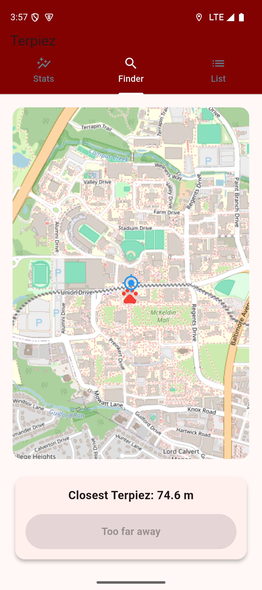

# Terpiez

Terpiez is a location-based creature-collection game designed and developed by [vikramvraja-dev](https://github.com/vikramvraja-dev) with Flutter and Dart. The implementation combines live location, an interactive map, device motion, persistent player state, local media caching, and a university-managed Redis service to create a mobile scavenger-hunt experience.

> Sanitization status: this history-free portfolio snapshot excludes generated runtime data and credentials. Redis host and port values are supplied at build time and are not committed to the repository.

## Project overview

Players use the Finder to locate the nearest uncaught Terpie. When a player is within 10 meters, shaking the device triggers a capture. The app records progress, caches creature details and images locally, and presents collection details and capture locations. Background location monitoring can notify the player when an uncaught Terpie is within 20 meters.

The source was reviewed for this portfolio preparation, but a clean build and end-to-end run have not yet been verified in the restricted review environment. The app also depends on an authorized university backend, so the complete experience is not standalone.

## Key features confirmed in the code

- Live geolocation with continuous position updates and automatic map centering.
- Nearest-creature search using geographic distance calculations.
- Motion-based capture using accelerometer data, a 10-meter proximity rule, and a cooldown to prevent duplicate catches.
- OpenStreetMap tiles rendered through `flutter_map`, with player and creature markers.
- Redis-backed authentication and retrieval of creature locations, metadata, and images.
- Secure credential storage plus persistent statistics, preferences, caught creatures, and capture coordinates.
- Local-first JSON and image caching for previously retrieved creature content.
- Foreground/background proximity detection and local notifications at 20 meters.
- Collection and detail views with creature imagery, statistics, descriptions, and maps of capture locations.
- Player statistics, sound effects, a sound preference, and a clear-data workflow.
- Responsive portrait/landscape layouts and a custom animated fragment-shader background.
- Connection monitoring with visible online/offline feedback.

## Screenshot

The repository currently contains one captured Finder screen:



Map data © [OpenStreetMap contributors](https://www.openstreetmap.org/copyright).

<!-- Add approved screenshots of the Stats, List, and detail screens here after checking them for private course or user data. -->

## Technologies used

- **Flutter and Dart** for the application and cross-platform project scaffolding.
- **Provider / ChangeNotifier** for application state and UI updates.
- **flutter_map, latlong2, and OpenStreetMap** for map rendering and coordinates.
- **geolocator** for location permissions, streams, and distance calculations.
- **sensors_plus** for accelerometer-based shake detection.
- **redis** for the course service connection and content retrieval.
- **flutter_secure_storage, shared_preferences, and path_provider** for credentials, player state, and cached files.
- **flutter_background_service, flutter_local_notifications, and permission_handler** for background proximity alerts.
- **audioplayers** for proximity and capture feedback.
- **GLSL fragment shaders** for the animated background.
- Native Flutter runner projects for Android, iOS, web, Linux, macOS, and Windows. Mobile-only integrations mean those targets have not all been verified.

Exact direct and transitive dependency versions are recorded in [`terpiez/pubspec.yaml`](terpiez/pubspec.yaml) and [`terpiez/pubspec.lock`](terpiez/pubspec.lock).

## Application architecture

The application uses a compact, feature-oriented structure:

| Area | Responsibility |
| --- | --- |
| `terpiez/lib/main.dart` | Startup, permissions, navigation, login, connectivity monitoring, Redis access, and the statistics screen. |
| `terpiez/lib/app_config.dart` | Central validation and compile-time loading of public Redis connection parameters. |
| `terpiez/lib/user_state.dart` | Provider-backed player state, persistence, location synchronization, progress updates, and UUID generation. |
| `terpiez/lib/finder_tab.dart` | Position and accelerometer streams, closest-Terpie selection, map UI, capture flow, and audio feedback. |
| `terpiez/lib/details_tab.dart` | Collection list, local-first content loading, detail presentation, and capture-location maps. |
| `terpiez/lib/background_service.dart` | Background location stream and proximity calculations. |
| `terpiez/lib/notification_helper.dart` | Notification channels, display, payload handling, and navigation back to the Finder. |
| `terpiez/lib/local_file_helper.dart` | JSON and Base64-decoded image persistence in the app documents directory. |
| `terpiez/lib/settings_drawer.dart` | Sound preferences and the clear-data interaction. |
| `terpiez/lib/shader_background.dart` | Fragment-shader loading, animation, and custom painting. |
| `terpiez/assets/` and `terpiez/shaders/` | App icon source, sound effects, and the custom shader. |
| Platform directories | Flutter runner code, manifests, permissions, icons, and build-system scaffolding required for supported targets. |

Server responses are currently represented as decoded maps rather than dedicated model classes. State is persisted through SharedPreferences, while creature JSON and images use a file cache. Credentials are handled separately through secure platform storage.

## Technical highlights

- The Finder performs an O(n) scan of available locations after position updates and uses geodesic distance calculations to select the nearest target.
- The capture interaction combines physical proximity, an accelerometer magnitude threshold, and a timed processing guard.
- Background and foreground execution share serialized location data through preferences, allowing a background isolate to calculate proximity without depending on the active widget tree.
- Collection screens use a local-first cache and fall back to Redis only when details or images are missing.
- Stream subscriptions, timers, map controllers, and audio players are explicitly managed across widget lifecycles.
- The UI adapts to device orientation and uses a custom GPU fragment shader for visual polish.

## Repository layout

```text
.
├── README.md
├── .gitignore
└── terpiez/
    ├── lib/                 # Dart application source
    ├── assets/              # Required icon source and sounds
    ├── shaders/             # Custom fragment shader
    ├── test/                # Flutter tests
    ├── android/             # Android runner and configuration
    ├── ios/                 # iOS runner and configuration
    ├── web/                 # Web runner
    ├── linux/               # Linux runner
    ├── macos/               # macOS runner
    ├── windows/             # Windows runner
    ├── pubspec.yaml         # SDK constraints, dependencies, and assets
    └── pubspec.lock         # Reproducible dependency resolution
```

Generated builds, dependency caches, IDE metadata, local SDK paths, captured emulator/app data, signing material, and secret configuration are excluded by `.gitignore`.

## Installation and running

### Prerequisites

- A Flutter stable release that includes a Dart SDK compatible with `^3.10.7`.
- An Android or iOS toolchain configured for Flutter. A physical mobile device is recommended for location, accelerometer, notification, and background-service behavior.
- Authorized backend credentials plus the Redis host and port supplied through Dart environment declarations. Do not put usernames or passwords in `--dart-define` values.

### Setup

From the repository root:

```bash
cd terpiez
flutter pub get
flutter analyze
flutter run \
  --dart-define=TERPIEZ_REDIS_HOST=<authorized-host> \
  --dart-define=TERPIEZ_REDIS_PORT=<authorized-port>
```

To run tests:

```bash
flutter test
```

The current test suite validates required Redis configuration without connecting to a server. Location, motion, background-service, notification, and end-to-end UI behavior still require device-level integration testing.

For a release build, use the Flutter command for the approved target only after release signing and backend configuration are set up. Do not commit signing files or local credentials.

## Security and configuration

The application loads `TERPIEZ_REDIS_HOST` with `String.fromEnvironment` and `TERPIEZ_REDIS_PORT` with `int.fromEnvironment`. All Redis connections use that central configuration. If either value is missing or invalid, the app displays a configuration error and avoids a connection attempt.

The source does not contain a hardcoded username or password. Users enter credentials at runtime, and the app stores them with `flutter_secure_storage`. This fresh snapshot excludes the original repository history and all captured app-sandbox data, including secure-storage and SharedPreferences files. Local configuration files such as `config/local.json` are ignored; only placeholder examples should ever be committed.

Build-time declarations are embedded in compiled applications. Do not publish APKs, app bundles, or other binaries built with a private university endpoint, and never pass usernames or passwords through `--dart-define`.

## University context and licensing

- Terpiez was developed individually as part of University of Maryland mobile application coursework. Permission to publish the source has been obtained.
- Confirm ownership and redistribution rights for the app icon, sound effects, and existing screenshot. Course-provided creature images and data are not included in this source snapshot.
- OpenStreetMap attribution is displayed in both map views; continue following the tile service usage policy when distributing or operating the app.
- Review the licenses and notices for all packages in `pubspec.lock` and include any required acknowledgements.
- Choose a repository license before publication. No top-level software license is currently present, so public availability alone would not grant reuse rights.
- Do not expose the university Redis hostname, credentials, or course-provided data in a public repository.

## Developer and individual contributions

Terpiez was designed and implemented by [vikramvraja-dev](https://github.com/vikramvraja-dev). The project demonstrates individual work across Flutter UI development, device APIs, persistence, networking, background execution, platform configuration, and iterative feature integration.

Key engineering contributions include:

- Designed the feature-oriented Flutter structure and Provider/ChangeNotifier state flow.
- Implemented continuous location tracking, nearest-target calculations, map presentation, and proximity rules.
- Combined accelerometer input with distance and cooldown guards to create the shake-to-catch interaction.
- Integrated authenticated Redis data access, connection monitoring, and secure runtime credential storage.
- Built local JSON/image caching and persisted player statistics, preferences, catches, and coordinates.
- Implemented foreground and background proximity notifications with navigation back to the Finder.
- Developed collection, statistics, settings, and detail interfaces with responsive layouts.
- Added audio feedback, lifecycle cleanup for streams/controllers, and a custom animated fragment shader.
- Configured the Android and iOS runners for location, notifications, background execution, icons, and release-oriented project scaffolding.

## Current verification status

- Source structure, declared dependencies, assets, and platform scaffolding have been inspected.
- Build, analyzer, and tests have not yet been run because Flutter and Dart tooling were not available on the command path in the review environment.
- Backend-dependent behavior has not been tested.
- Android/iOS runtime behavior and all desktop/web targets remain unverified.
- Configuration validation has focused unit coverage; device and integration coverage remains future work.

This project should be described as an inspected individual university project—not as a production-ready release—until the remaining device and integration validation work is complete.

